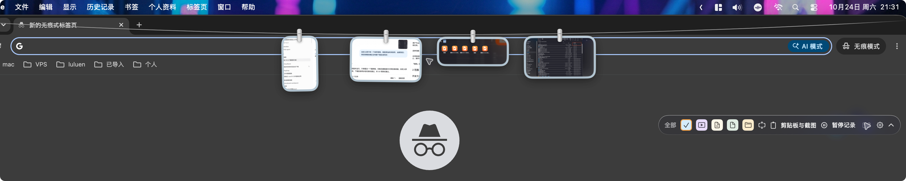
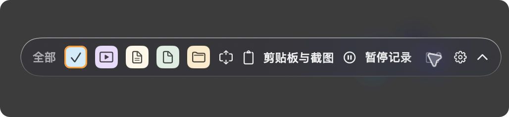
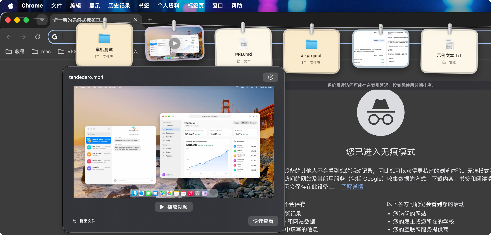

# EasyTake · 随取

**Your files, within reach.**

一款原生 macOS 挂绳文件取用工具。将鼠标停在屏幕顶边，展开挂绳，从最近访问、下载目录或剪贴板中预览、复制和拖出文件，继续手上的工作。

EasyTake 是基于 **[Tendedero](https://github.com/alejandrobujan/tendedero)** 开发的独立修改版。原项目由 **Alejandro Buján** 创作，以挂绳、夹子和卡片呈现截图与录屏。随取沿用这套原生界面与交互，在现有工程上增加文件来源、多文件类型、类型背景色与筛选。感谢原作者的开源工作。

当前版本：**0.1.4 · 开发预览版**。支持 macOS 14 及以上，构建产物包含 Apple silicon 与 Intel 两种架构。



## 在参考项目上增加了什么

| 增量功能 | 随取中的行为 |
| --- | --- |
| 最近访问 | 合并本应用打开、成功拖出的记录与 Spotlight 可获得的最近使用文件，按真实使用时间倒序排列 |
| 自定义文件夹源 | 添加下载、截图或素材目录，在同一条挂绳中切换；显示直属项目，统一按访达“添加日期”由新到旧排列 |
| 更多文件类型 | 从图片扩展到视频、文本、普通文件和文件夹；文本可阅读、滚动与选择，视频可显式播放、暂停和定位进度 |
| 类型背景色 | 图片浅蓝、视频浅紫、文本暖白、普通文件浅灰绿、文件夹浅米色，浅色卡片配深色文字 |
| 类型筛选 | 点击类型按钮单选筛选，点击“全部”恢复；筛选后再选取最新 20 项，避免目标类型被其他文件挤出 |

**沿用的核心能力**：弯曲挂绳、夹子与卡片、截图与录屏识别和飞入动效、卡片大小、横向滚动、单击复制、双击打开、图片长按标注、视频长按裁剪、系统 Quick Look，以及声音和登录启动等设置。各项真实交互的验收进度见下文。

**针对文件来源调整的行为**：拖出仅复制；移除历史或来源不删除用户原件；不强制改变系统截图保存目录；剪贴板记录默认关闭，需主动开启。

随取使用自己的名称、图标、Bundle ID 和数据目录，不代表 Tendedero 官方版本或获得原作者背书。完整来源说明见 [NOTICE.md](NOTICE.md)，原项目说明保留在 [README.upstream.md](README.upstream.md)。

## 快速使用

1. 将应用放入“应用程序”并启动。点击菜单栏闪电图标，或将鼠标停在屏幕最上沿约 0.5 秒，展开挂绳；默认也可按 **F2** 切换。
2. 在来源菜单选择“最近访问”“剪贴板与截图”，或点击“添加来源”选择文件夹。也可将访达中的文件夹拖到工具条的添加来源入口。
3. 使用类型按钮缩小范围，悬停卡片预览；单击复制，双击用系统应用打开，或拖到支持接收文件的应用中。
4. 在预览中阅读文本，或点击“播放视频”开始播放。移出挂绳和预览区域后，挂绳会自动收起。

呼出等待时间、快捷键、卡片大小等可在设置中调整。后续启动会恢复上次来源与类型筛选。



### 自定义来源如何更新

- 只显示来源根目录的直属项目，不展开子文件夹，默认取最新 20 项。
- 只有一种排序：系统“添加日期”倒序，与访达同名列的含义一致；不以创建时间或修改时间代替。
- 添加日期相同以文件名保持稳定顺序，缺少添加日期的项目排在后面。
- 显示期间监听目录变化，并每 2 秒补查；隐藏期间暂停扫描，重新呼出时补查。
- 新建、移入、重命名和删除会更新候选；编辑内容仍以添加日期排序。
- 大目录扫描有数量与时间上限，结果不完整时会显示说明。

### 剪贴板与第三方截图

“剪贴板与截图”来源中的剪贴板记录默认关闭。点击 **“开启记录”** 后，下一次复制的文本、文件或图片会进入该来源；关闭记录不会清空已有历史。

PixPin 等工具复制到剪贴板的截图可通过此入口记录。仅保存到磁盘、没有复制到剪贴板的截图，需要添加其保存目录。查看文件夹来源时，新截图不会强制切走当前来源。

### 预览

| 类型 | 预览方式 |
| --- | --- |
| 图片 | 悬停显示清晰大图，大图可作为拖出入口 |
| 文本 | 原生可选择文本视图，支持 UTF-8、UTF-16 与 RTF 正文；读取超过 4 MB 时提示截断，可用系统快速查看阅读完整文件 |
| 视频 | 悬停先显示静态帧，点击播放后使用 AVKit 控件；关闭预览时停止播放 |
| 其他文件 | 通过系统 Quick Look 查看系统支持的格式 |



## 数据与原件保护

- 文件夹来源保存访问引用，不复制或移动整个目录。
- 拖出采用复制语义；移除来源、移除历史或取消拖动不会删除用户原件。
- 历史清理只会删除随取自行生成的剪贴板缓存资产。
- 识别常见私密、临时剪贴板标记，并忽略随取自身触发的复制。
- 最近访问依赖系统可用的 Spotlight 索引和访问权限，结果可能存在延迟；索引不足时保留本应用使用记录并显示状态。
- 当前功能在本机运行，无账号、云同步或遥测服务。

## 从源码构建

需要 macOS 及可用的 Xcode 或 Command Line Tools。工程使用 SwiftPM、AppKit、SwiftUI 和系统框架，无第三方包依赖。

在仓库根目录执行：

```bash
# 自动测试与翻译表检查
swift test
swift scripts/check-strings.swift

# 构建双架构应用
scripts/build-app.sh release

# 使用刚构建的应用生成 DMG
scripts/make-dmg.sh release --skip-build
```

当前构建输出为 `build/随取.app` 和 `build/Suiqu-0.1.4.dmg`。将应用安装到 `/Applications` 后，清理构建副本与旧版 `.app` 备份，避免启动器出现重复应用。

未配置 Developer ID 时，构建脚本使用 ad hoc 签名；当前本地开发包尚未经过 Apple 公证。打包脚本只在本地生成文件，不上传或发布。

| 项目 | 当前值 |
| --- | --- |
| 英文项目名 / GitHub 仓库 | EasyTake / [lulalulaluobo/EasyTake](https://github.com/lulalulaluobo/EasyTake) |
| macOS 应用名 | 随取 |
| SwiftPM 目标 / 可执行文件 | `Suiqu` |
| Bundle ID | `local.suiqu.app` |
| 应用数据目录 | `~/Library/Application Support/Suiqu` |

英文项目名使用 EasyTake；当前内部目标、应用标识及安装包前缀仍为 `Suiqu`，便于现有安装继续读取配置。

## 当前验证与限制

0.1.4 已完成双架构构建、签名与 DMG 校验。2026-10-24 在 Mac mini（Apple M4、16 GB、macOS 26.5）上，包含本机可选集成检查的 **30 项测试通过**，覆盖来源恢复、添加日期排序、目录变化与隐藏补查、原件保护、剪贴板载荷、最近访问、预览生命周期及悬停调度。

默认 `swift test` 会跳过依赖本机已配置下载来源的只读集成检查。已有 Downloads 来源配置时，可额外执行：

```bash
SUIQU_VERIFY_DOWNLOADS=1 swift test
```

开发机上的真实下载来源最新 20 项已与系统添加日期倒序逐项对照。该结果验证数据读取和挂绳模型，自动测试与编译通过不等于全部真实交互已验收。

仍在验证跨 App 拖放与取消、文本和视频控件的完整交互、第三方截图全流程、多屏和全屏、权限失效、云端占位文件，以及系统截图设置恢复等场景。当前适合参与测试和反馈，完整记录见 [开发与验证记录](docs/DEVELOPMENT.md)。

## 开发文档

- [产品需求与验收范围](PRD.md)
- [开发与验证记录](docs/DEVELOPMENT.md)
- [开发约束](AGENTS.md)

## 致谢与许可

参考项目：[Tendedero](https://github.com/alejandrobujan/tendedero)，作者 Alejandro Buján。本项目基于上游 1.6.0、提交 `32a3e47187fdea7b2fd43b3ab5a913f0ed33724a` 增量开发。

源代码沿用 [MIT License](LICENSE)，保留原版权和许可声明。上游名称、图标及品牌素材不包含在其 MIT 源代码授权范围内；随取使用独立的橙色闪电文件图标。详见 [NOTICE.md](NOTICE.md)。
